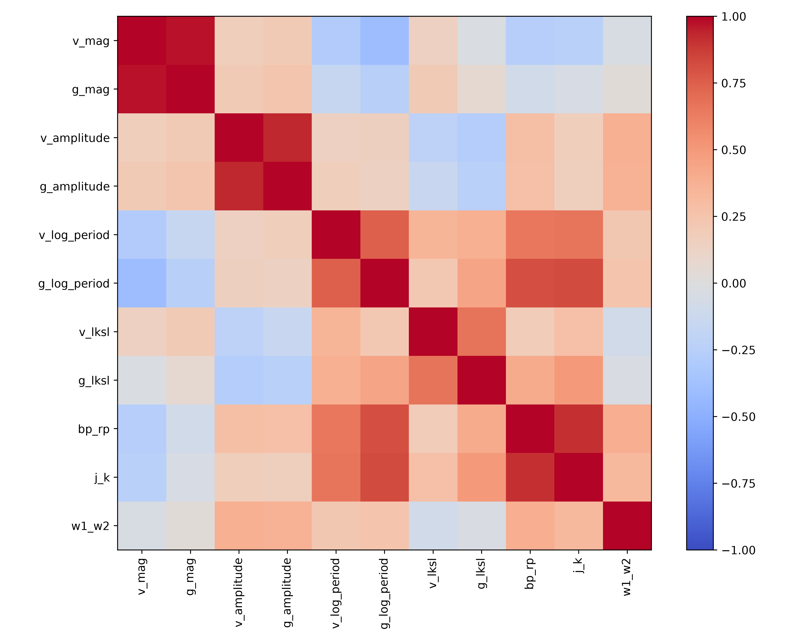

# star-classication-project
Project for FSU CIS4930 Data Mining

# correlations

V and g magnitudes: 0.98

V and g amplitudes: 0.93

BP-RP and J-K color indices: 0.91

g-band log-period and J-K: 0.82

# pca

| Feature | PC1 | PC2 | PC3 | PC4 | PC5 | PC6 | PC7 | PC8 |
|---|---:|---:|---:|---:|---:|---:|---:|---:|
| v_mag | -0.189 | 0.319 | 0.514 | 0.094 | -0.211 | 0.140 | 0.066 | 0.070 |
| g_mag | -0.103 | 0.331 | 0.541 | 0.132 | -0.278 | 0.117 | 0.025 | 0.030 |
| v_amplitude | 0.119 | 0.548 | -0.133 | -0.313 | 0.153 | -0.192 | 0.070 | 0.041 |
| g_amplitude | 0.119 | 0.549 | -0.090 | -0.341 | 0.212 | -0.142 | 0.031 | -0.056 |
| v_log_period | 0.409 | -0.028 | 0.025 | -0.213 | 0.053 | 0.761 | 0.276 | -0.354 |
| g_log_period | 0.454 | -0.052 | -0.050 | -0.077 | -0.235 | 0.074 | 0.181 | 0.823 |
| v_lksl | 0.171 | -0.180 | 0.483 | -0.201 | 0.585 | 0.064 | -0.530 | 0.184 |
| g_lksl | 0.265 | -0.250 | 0.399 | -0.000 | 0.197 | -0.490 | 0.631 | -0.178 |
| bp_rp | 0.455 | 0.077 | -0.007 | 0.109 | -0.276 | -0.195 | -0.321 | -0.298 |
| j_k | 0.455 | 0.011 | 0.070 | 0.128 | -0.310 | -0.177 | -0.303 | -0.165 |
| w1_w2 | 0.197 | 0.287 | -0.127 | 0.800 | 0.446 | 0.109 | 0.079 | 0.078 |

the cnn will use time series data, but for the mlp we decide inputs with this ^^^

# dataset splitting
divide the matched stars into training, validation, and testing datasets using an approximately 70/15/15 stratified split

998 stars with competing classifications: set aside until we figure out what to do
